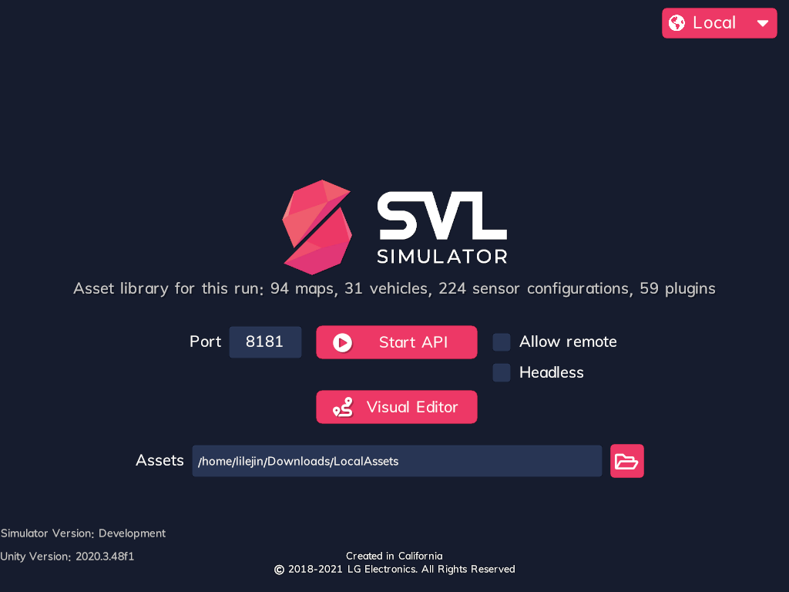

# SVL Simulator

[Build instructions](#building-from-source) · [Asset library](#local-asset-library) · [Docker](Docker/README.md)



## Overview

This fork runs SVL Simulator without the WISE cloud service. The `assets` branch loads prebuilt SVL/WISE asset
bundles and their metadata from a local library. Maps, vehicles and plugins remain separate from the player and
are loaded at runtime. The simulator starts an API Only simulation by default, accepting connections from
`lgsvl` PythonAPI 2021.3 on port 8181. Existing WISE IDs, including those in `lgsvl.wise.DefaultAssets`, are
preserved for API compatibility.

The branches use different asset formats and build workflows:

| Branch | Asset distribution | Local layout | Runtime behavior |
|--------|--------------------|--------------|------------------|
| `assets` | [lilejin322/svl-assets](https://huggingface.co/datasets/lilejin322/svl-assets): prebuilt bundles and WISE metadata | `LocalAssets/maps/`, `vehicles/`, `plugins/`, `metadata/` and startup assets | Load bundles from the configured library. |
| [`unity-2020`](https://github.com/lilejin322/simulator/tree/unity-2020) | [lilejin322/svl-content](https://huggingface.co/datasets/lilejin322/svl-content), branch `unity-2020`: asset source archives for Unity 2020.3.48f1 | `Assets/<category>/<folder>/`, selected by `build-assets.yaml` | Compile selected assets into the player. |
| [`main`](https://github.com/lilejin322/simulator/tree/main) | [lilejin322/svl-content](https://huggingface.co/datasets/lilejin322/svl-content), branch `main`: the same sources upgraded for Unity 6000.6.7f1 | `Assets/<category>/<folder>/`, selected by `build-assets.yaml` | Compile selected assets into the player. |
| [`mac`](https://github.com/lilejin322/simulator/tree/mac) | [lilejin322/svl-content](https://huggingface.co/datasets/lilejin322/svl-content), branch `mac`: the `main` sources with four packages changed for macOS as well as Linux | `Assets/<category>/<folder>/`, selected by `build-assets.yaml` | Compile selected assets into the player. |

The instructions below apply to `assets`. Use separate checkouts when working with several branches: switching Git
branches leaves downloaded asset directories on disk, and Unity imports files under `Assets/`.

## Building from source

### Requirements

- Linux x86_64 with Bash and GNU command-line utilities. For macOS, use the `mac` branch.
- Unity **2020.3.48f1** with Linux build support, matching [ProjectVersion.txt](ProjectSettings/ProjectVersion.txt).
- A GPU and driver with Vulkan support.
- Git and Git LFS to retrieve the repository's binary files.
- Xvfb (`xvfb-run`) and `xauth` for builds and headless execution.
- `curl`, `dpkg-deb` and `sha256sum` to prepare Unity's compatibility libraries.
- Python 3 to check the asset library, and the Hugging Face `hf` CLI to download missing bundles.

Allow space for the bundle dataset, Unity's import cache and the player build. The download size can be inspected
before fetching the library:

```bash
hf download lilejin322/svl-assets --repo-type dataset --exclude .gitattributes --dry-run
```

### Build the player

Clone the `assets` branch with Git LFS enabled, then run from the repository root:

```bash
./build.sh
```

The script prepares missing OpenSSL 1.1 compatibility libraries, locates Unity, downloads the bundle library if
needed, and builds the Linux player into `build/`. The Unity log is written to `Logs/build-linux64.log`.

The required editor version is discovered in Unity Hub or unity CLI installation directories. Set `UNITY` for
a custom installation path. The first positional argument selects an output directory; remaining arguments
are passed to Unity:

```bash
UNITY=/path/to/Editor/Unity ./build.sh
./build.sh build-debug -developmentBuild
```

OpenSSL 1.1 libraries are downloaded from Ubuntu's package archive, verified against a pinned SHA-256, and
extracted into `.build-tools/lib/`. Both libraries are reused when present; a missing or empty library triggers
setup again. This step requires no sudo and does not install system packages. The script sets
`LD_LIBRARY_PATH` for Unity and enables .NET invariant globalization for its older compiler. Xvfb is provided
by the operating system.

After a successful build, the script creates `build/config.yml` from [config.yml.template](config.yml.template)
if no configuration exists. It sets `assets_path` to the absolute path of the repository's `LocalAssets/`.
Existing configuration files are preserved. When moving a player to another host, copy the library separately
and update `assets_path` for its new location.

### Download the bundle library

`build.sh` uses the dataset [lilejin322/svl-assets](https://huggingface.co/datasets/lilejin322/svl-assets) and
downloads it into `LocalAssets/`. To prepare only the runtime library, for example on a Docker host or for an
existing player, run:

```bash
hf download lilejin322/svl-assets --repo-type dataset --local-dir LocalAssets --exclude .gitattributes
```

The dataset is public. The `hf` CLI uses its configured authentication when needed.

When a cached file listing is available in `LocalAssets/.cache/huggingface/trees/`, `build.sh` checks that every
listed file except `.gitattributes` exists with the expected size. Missing files, incomplete files or a missing
listing trigger `hf download`. Keep the `.cache/huggingface/` directory so downloads can reuse completed files
and subsequent builds can check the library. Older CLI versions that do not save a listing may contact the Hub
on every build.

A complete cached library is reused without checking for a newer dataset revision. Run the download command
explicitly to refresh it. These are runtime bundles; changing the library does not require rebuilding the player.

## Local asset library

The dataset is downloaded directly into the following layout. Keep bundle files intact; they are not asset
source archives to extract into the Unity project.

```text
LocalAssets/
  maps/                   Map bundles, normally named by assetGuid
  vehicles/               Vehicle bundles, normally named by assetGuid
  plugins/                Sensor and bridge plugin bundles
  metadata/
    maps.json             WISE map records
    vehicles.json         Vehicle records and sensor configurations
    plugins.json          WISE plugin records
    LICENSE               Metadata attribution and license
  npcs/                   NPC bundles, including category subdirectories
  pedestrians/            Pedestrian bundles, including category subdirectories
  controllables/          Controllable bundles
  hdmaps/<assetGuid>/      Supplemental HD map files
  LICENSE
  README.md
```

Maps, vehicles and plugins are loaded on demand. NPCs, pedestrians and controllables are loaded at startup.
The `hdmaps/` files are supplied for external tools and autonomy stacks; the simulator's asset-library loader
does not scan this directory for bundles.

### Metadata and asset lookup

`metadata/*.json` uses the WISE record format preserved by [SORA-SVL](https://github.com/YuqiHuai/SORA-SVL).
Each file contains an array of records with `cid`, `endpoint` and `data`. Vehicle records also use `ctype` to
distinguish a vehicle from a sensor configuration:

```json
{
  "cid": "<WISE ID>",
  "ctype": "vehicle",
  "endpoint": "/api/v1/vehicles/<WISE ID>",
  "data": {
    "name": "<vehicle name>",
    "assetGuid": "<bundle assetGuid>"
  }
}
```

This is a structural example; existing records contain additional fields. Preserve the metadata alongside the
bundles to retain public asset names, WISE IDs and vehicle sensor configurations. Bundles without metadata are
listed using their `manifest.json` identity.

Assets can be selected by WISE ID, assetGuid or name. When names are ambiguous, lookup first prefers records
with an available bundle, then records published by "SVL Content". If several matches remain, use an ID.
Selecting a vehicle by a sensor-configuration ID includes that configuration's sensors and bridge. Selecting
by name uses the first configuration's sensors without connecting a bridge.

### Adding bundles

Bundles built with `Simulator/Build...` can be copied into `maps/`, `vehicles/` or `plugins/`. Filenames that are
not assetGuids are resolved through the bundle manifest. Use bundles compatible with the project's Unity and
SVL asset-format versions.

The official SVL 2021.3 release also contains startup bundles under `AssetBundles/NPCs`, `Pedestrians` and
`Controllables`. They can be placed in the library's lowercase `npcs/`, `pedestrians/` and `controllables/`
directories. The simulator also scans `AssetBundles/` beside the player for startup bundles. When the same
asset is present in both locations, the library copy takes precedence.

## Running the simulator

Start the built player with a window or in headless mode:

```bash
./build/simulator
# Or run without a window:
./run-headless.sh
```

With the default configuration, Python API clients connect to `localhost:8181`:

```python
import lgsvl

sim = lgsvl.Simulator("localhost", 8181)
```

### Configuration

Place `config.yml` beside the player executable, or in the project root when running in the Unity Editor:

```yaml
api_hostname: "localhost"
api_port: 8181
assets_path: "/path/to/LocalAssets"
start_api_only: true
headless: false
```

Asset-path settings are applied in this order, with later settings taking precedence:

| Setting | Path interpretation |
|---------|---------------------|
| Default `LocalAssets` | Relative to the player directory, or the project root in the Editor. |
| `assets_path` in `config.yml` | Relative to the same directory unless absolute. |
| `SIMULATOR_ASSETS` environment variable | Absolute, or relative to the process working directory. |
| Player argument `--assets <path>` | Absolute, or relative to the process working directory. |

For example:

```bash
./run-headless.sh --assets /path/to/LocalAssets --apiport 8182 --data "$HOME/svl-data-2"
```

`--no-api-only` disables automatic API startup for that run. To accept remote clients, set `api_hostname: "*"`
or pass `--apihost '*'`, and allow the API port through the host firewall.

If the asset-library directory does not exist, the simulator reports an error and does not start the Python
API. In batch mode it exits with code 1; with a window, the loader allows a different folder to be selected.
A missing bundle fails when requested rather than being downloaded from WISE.

Bundles are linked into the runtime data directory on Linux and copied on platforms without link support.
Clearing this cache does not remove library files. Changing or moving the library invalidates stale cache
links; keep the library available while the simulator runs.

### Headless execution and multiple instances

`run-headless.sh [path/to/simulator] [arguments...]` starts the player through system Xvfb with Unity batch
mode and Vulkan rendering. A GPU is still required. Batch mode renders sensor views without a main window.

Each instance needs its own API port and data directory:

```bash
./run-headless.sh --apiport 8181 --data "$HOME/svl-data-1"
./run-headless.sh --apiport 8182 --data "$HOME/svl-data-2"
```

Run these in separate terminals or process supervisors. The read-only asset library can be shared. The
`-force-device-index N` player argument selects a Vulkan device; its index may differ from `nvidia-smi`.

### Loader screen

With `start_api_only: false`, the loader provides an API port field, "Allow remote" and "Headless" checkboxes,
and an "Assets" field. A folder chooser is available when `zenity` is installed. Changes apply to the current
run and are not saved to `config.yml`.

Confirming the Assets field rescans the library, even when the path is unchanged. Maps, vehicles and plugins
use the selected library immediately. Startup assets already loaded remain in memory, with new assets added
from the selected library; restart to replace the complete startup set.

## Docker

The Docker image contains the player and Xvfb. The bundle library is mounted separately, read-only at `/assets`,
and runtime data is stored in a writable `/data` mount:

```bash
./build.sh
docker build -f Docker/Dockerfile -t svlsimulator .
Docker/run.sh 8181 0 "$PWD/LocalAssets" "$HOME/svl-data-1"
```

Container hosts need an NVIDIA GPU, driver and the NVIDIA Container Toolkit. See the
[Docker guide](Docker/README.md) for image distribution, shared libraries, multiple instances and bridge
connections.

## Project background

SVL Simulator was developed by LG Electronics America R&D Lab as a Unity HDRP simulator for autonomous driving
and robotics. LG suspended active development of the original project on January 1, 2022. This fork replaces
the WISE service connection with a local bundle library and API startup workflow.

## Citation

Research using SVL Simulator should cite the ITSC 2020 paper:
[LGSVL Simulator: A High Fidelity Simulator for Autonomous Driving](https://arxiv.org/pdf/2005.03778).

```bibtex
@article{rong2020lgsvl,
  title={LGSVL Simulator: A High Fidelity Simulator for Autonomous Driving},
  author={Rong, Guodong and Shin, Byung Hyun and Tabatabaee, Hadi and Lu, Qiang and Lemke, Steve and Mo{\v{z}}eiko, M{\=a}rti{\c{n}}{\v{s}} and Boise, Eric and Uhm, Geehoon and Gerow, Mark and Mehta, Shalin and others},
  journal={arXiv preprint arXiv:2005.03778},
  year={2020}
}
```

## Copyright and License

Copyright (c) 2019-2021 LG Electronics, Inc.

See [LICENSE](LICENSE) for the software license and [LICENSE-3RD-PARTY](LICENSE-3RD-PARTY) for third-party
licenses and attribution. The asset dataset includes its own `LICENSE` and `metadata/LICENSE`; retain asset
attribution and license information when distributing a library.
